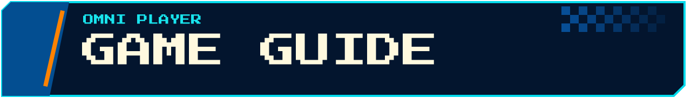

# Omni Player — Game Guide

Find your game, choose the edition listed below, then open **Omni → Load Game** and select the matching original. Omni includes the compatibility bridges. You supply the original game files.

[Get Omni Player v0.6.0](https://github.com/Wakkatobakka/Omni-Player/releases/tag/v0.6.0) · [Search the Public Pile](https://wakkatobakka.github.io/#games) · [Setup and help](README.md)

**Looking for iPhone games?** Use the [Apple Bridge Game Guide](https://github.com/Wakkatobakka/Apple-Bridge/blob/main/GAME_GUIDE.md#choose-a-game) to find the matching original IPA, then load it in Omni.

Choose a game
-------------

This list covers the 58 games outside the iPhone collection in the APK attached to the Omni Player v0.6.0 release. Tap a game name for the exact filename and import notes. A few source pages offer several editions. For those, follow the choices in the game’s notes. For DoJa, use the named entry and variant in [Keitai World Launcher](https://keitaiarchive.org/downloads.html).

| Game | Platform and edition | Original file |
| --- | --- | --- |
| [Age of Empires II Mobile](#game-age-of-empires-ii-mobile) | ExEn · English · V01.00.50 | [Choose ExEn download](https://www.myabandonware.com/game/age-of-empires-ii-mobile-wh8) |
| [Age of Empires III](#game-age-of-empires-iii) | J2ME · English · Nokia 128×128 · v1.0.2 | [Download JAR](https://archive.org/download/HugeJavaMobileGameDump/Huge%20Java%20Mobile%20Game%20Dump%20%28mastiwap%20dir%203%20-%20nokia%29.zip/Nokia%20Games%2F128x128_s40%2FStrategy%2FAge%20of%20empires_3.jar) |
| [Ashen](#game-ashen) | N-Gage · Classic N-Gage edition | [Download RAR](https://archive.org/download/ngagecrackedgamescollection/N-Gage%20cracked%20games%20collection.rar/N-Gage%20cracked%20games%20collection%2FAshen.rar) |
| [Baldur's Gate](#game-baldur-s-gate) | J2ME · Sorrent · English · v1.0.0 · 176×208 | No verified download yet |
| [Banjo-Kazooie: Grunty’s Revenge Missions](#game-banjo-kazooie-grunty-s-revenge-missions) | ExEn · English | [Choose ExEn download](https://www.myabandonware.com/game/banjo-kazooie-grunty-s-revenge-missions-yz7) |
| [Biohazard: The Episodes](#game-biohazard-the-episodes) | DoJa · Japanese · offline edition | [Keitai World Launcher entry](https://wakkatobakka.github.io/doja-archive/games/biohazard-the-episodes--76526ae6/index.html) |
| [BioShock 3D](#game-bioshock-3d) | BREW · English · 176 BREW build | [Download RAR](https://archive.org/download/qualcomm-brew-games/Qualcomm%20BREW%20Games.zip/brew2010%2FBioShock3D_176.rar) |
| [Bounce Boing Voyage](#game-bounce-boing-voyage) | N-Gage 2.0 · Nokia 5320 compatibility profile | [Download .n-gage](https://archive.org/download/Dance.Fabulous.nGage/N-Gage%202.0/Games/Full/Bounce.Boing.Voyage.n-gage) |
| [Brothers in Arms](#game-brothers-in-arms) | BREW · 240-screen BREW edition | [Download RAR](https://archive.org/download/qualcomm-brew-games/Qualcomm%20BREW%20Games.zip/brew2010%2FBIA240.rar) |
| [Chokkan Crash](#game-chokkan-crash) | DoJa · Japanese | [Keitai World Launcher entry](https://wakkatobakka.github.io/doja-archive/games/chokkan-crash-bandicoot--881af37b/index.html) |
| [Contra 4 Redux](#game-contra-4-redux) | BREW · English | No verified download yet |
| [Crash Bandicoot](#game-crash-bandicoot) | ExEn · English · original v1.9 | [Choose ExEn download](https://www.myabandonware.com/game/crash-bandicoot-yy7) |
| [Crash Nitro Kart](#game-crash-nitro-kart) | N-Gage · Classic N-Gage edition | [Download RAR](https://archive.org/download/ngagecrackedgamescollection/N-Gage%20cracked%20games%20collection.rar/N-Gage%20cracked%20games%20collection%2FCrash%20Nitro%20Kart.rar) |
| [DDR SA](#game-ddr-sa) | J2ME · Original v0.4 · boxon · 2006 | [Download JAR from boxon](https://kumisuke.jp/boxon/gamessa/ddrsa/DDRSA.jar) |
| [Dead Rising](#game-dead-rising) | J2ME · v1.0.1 · 176×208 | No verified download yet |
| [DeadShot](#game-deadshot) | DoJa · English · Devil May Cry: DeadShot | [Keitai World Launcher entry](https://wakkatobakka.github.io/doja-archive/games/devil-may-cry-deadshot--ae689f62/index.html) |
| [Digital Devil Story: Megami Tensei](#game-digital-devil-story-megami-tensei) | J2ME · English | [Choose English J2ME](https://www.myabandonware.com/game/digital-devil-story-megami-tensei-9sz) |
| [Dirge of Cerberus: Lost Episode](#game-dirge-of-cerberus-lost-episode) | DoJa · English patch · complete English 1.0 package | [Keitai World Launcher entry](https://wakkatobakka.github.io/doja-archive/games/final-fantasy-7-dirge-of-cerberus-lost-episode--d29675e2/index.html) |
| [DOOM II RPG](#game-doom-ii-rpg) | BREW · English · LG AX830 | [Download ZIP](https://archive.org/download/qualcomm-brew-games/Qualcomm%20BREW%20Games.zip/brew2018%2Fd2rp.zip) |
| [DOOM RPG](#game-doom-rpg) | BREW · English | [Download ZIP](https://archive.org/download/doomrpg_brew/doomrpg.zip) |
| [Dragon Island](#game-dragon-island) | BREW · English · Macrospace v1.0.2 · 240×320 | [Download RAR](https://archive.org/download/qualcomm-brew-games/Qualcomm%20BREW%20Games.zip/brew2010%2FDragonIsland_320.rar) |
| [Dragon Sword](#game-dragon-sword) | BREW · English · v1.0.0 · 240×320 | [Download RAR](https://archive.org/download/qualcomm-brew-games/Qualcomm%20BREW%20Games.zip/brew2010%2FDragonSword.rar) |
| [Driv3r](#game-driv3r) | BREW · BREW edition | [Download RAR](https://archive.org/download/qualcomm-brew-games/Qualcomm%20BREW%20Games.zip/brew2010%2FDriv3r.rar) |
| [Duke Nukem 3D](#game-duke-nukem-3d) | BREW · BREW edition | [Download RAR](https://archive.org/download/qualcomm-brew-games/Qualcomm%20BREW%20Games.zip/brew2010%2FDukeNukem3D_114.rar) |
| [Earthworm Jim: Special Edition](#game-earthworm-jim-special-edition) | BREW · English | No verified download yet |
| [Final Fantasy VII: Snowboarding](#game-final-fantasy-vii-snowboarding) | DoJa · English · offline edition | [Keitai World Launcher entry](https://wakkatobakka.github.io/doja-archive/games/final-fantasy-7-snowboarding--9d7097ec/index.html) |
| [God of War: Betrayal](#game-god-of-war-betrayal) | J2ME · Nokia 352×416 · v1.4.58 · 6 languages | [Download multi-edition ZIP](https://archive.org/download/j2me-hipnosis/God%20of%20War%20-%20Betrayal.zip) |
| [Kingdom Hearts V CAST](#game-kingdom-hearts-v-cast) | BREW · English · recovered chapters | [Download ZIP from Drive](https://drive.usercontent.google.com/download?id=15vA80gl_MJCKEUyAm8aFytDU8vwz0KiM&export=download) |
| [Lost in Blue Mobile](#game-lost-in-blue-mobile) | DoJa · Japanese · Marina & Riku · Patched | [Keitai World Launcher entry](https://wakkatobakka.github.io/doja-archive/games/lost-in-blue-mobile-marina-riku-hen--a9ceb499/index.html) |
| [Mega Man: Rush Marine](#game-mega-man-rush-marine) | BREW · English · v1.1.11 | [Choose BREW 1.1.11](https://www.myabandonware.com/game/mega-man-rush-marine-vw9) |
| [Metal Gear Solid Mobile](#game-metal-gear-solid-mobile) | BREW · English · US full game | [Download US BREW ZIP](https://archive.org/download/mgsmobile_us_full_unsigned/mgsmobile_us_full_unsigned.zip) |
| [Monster Hunter i](#game-monster-hunter-i) | DoJa · English patch and Japanese · one title with two language editions | [Keitai World Launcher entry](https://wakkatobakka.github.io/doja-archive/games/monster-hunter-i-for-sh--c05e73b0/index.html) |
| [Mutant Alert](#game-mutant-alert) | ExEn · English · v1.2 | [Choose ExEn download](https://www.myabandonware.com/game/mutant-alert-yym) |
| [Need for Speed Carbon](#game-need-for-speed-carbon) | Zeebo / BREW · Portuguese (Brazil) · Domine a Cidade | [Download Zeebo ZIP](https://archive.org/download/zeebo-arquivista/Need%20For%20Speed%20-%20Carbon%20-%20Domine%20a%20Cidade.zip) |
| [Nowhere](#game-nowhere) | J2ME · English · Sony Ericsson K790 · v01.00.05 | [Choose Sony Ericsson K790](https://www.myabandonware.com/game/nowhere-w3p) |
| [Orcs & Elves II](#game-orcs-elves-ii) | BREW · English · v7.0.41 | [Download BREW ZIP](https://archive.org/download/qualcomm-brew-games/Qualcomm%20BREW%20Games.zip/brew2018%2Foe2.zip) |
| [Pocket Kingdom: Own the World](#game-pocket-kingdom-own-the-world) | N-Gage · USA / Europe · English, French, German, Spanish, Italian · 08.11.2004 | [Choose USA/Europe 08.11.2004](https://www.myabandonware.com/game/pocket-kingdom-own-the-world-ms1) |
| [Quake II](#game-quake-ii) | Zeebo / BREW · Portuguese (Brazil) | [Download Zeebo ZIP](https://archive.org/download/zeebo-arquivista/Quake%202.zip) |
| [Ratchet & Clank: Going Mobile](#game-ratchet-clank-going-mobile) | J2ME · English · v1.0.10 | [Choose first v1.0.10](https://www.myabandonware.com/game/ratchet-clank-going-mobile-wvd) |
| [Resident Evil 4](#game-resident-evil-4) | Zeebo / BREW · Spanish / Portuguese | [Choose Zeebo download](https://www.myabandonware.com/game/resident-evil-4-mobile-edition-t3v) |
| [Resident Evil: Degeneration](#game-resident-evil-degeneration) | N-Gage 2.0 · Nokia 5320 compatibility profile | [Download .n-gage](https://archive.org/download/Dance.Fabulous.nGage/N-Gage%202.0/Games/Full/Resident.Evil.Degeneration.n-gage) |
| [Resident Evil: Genesis](#game-resident-evil-genesis) | BREW · English | [Download RAR](https://archive.org/download/qualcomm-brew-games/Qualcomm%20BREW%20Games.zip/brew2010%2FREGenesis.rar) |
| [Resident Evil: Uprising](#game-resident-evil-uprising) | J2ME · Glu Mobile · v1.0.0 | No verified download yet |
| [Rockman: Great Adventure on 5 Islands](#game-rockman-great-adventure-on-5-islands) | DoJa · English patch · Localized | [Keitai World Launcher entry](https://wakkatobakka.github.io/doja-archive/games/rockman-dash-great-adventure-on-5-islands--ad429f85/index.html) |
| [Rolling with Katamari](#game-rolling-with-katamari) | BREW · English | [Download BREW RAR](https://archive.org/download/qualcomm-brew-games/Qualcomm%20BREW%20Games.zip/brew2010%2FKatamari.rar) |
| [Silent Hill: Orphan](#game-silent-hill-orphan) | J2ME · 240×320 · six original languages | [Get silenthill.jar](https://www.mediafire.com/file/27xqe2zxd01caj5/silenthill.jar/file) |
| [Sonic Jump](#game-sonic-jump) | DoJa · English patch | [Keitai World Launcher entry](https://wakkatobakka.github.io/doja-archive/games/sonic-jump--48b3c9a0/index.html) |
| [Sonic N](#game-sonic-n) | N-Gage · Classic N-Gage edition | [Download RAR](https://archive.org/download/ngagecrackedgamescollection/N-Gage%20cracked%20games%20collection.rar/N-Gage%20cracked%20games%20collection%2FSonicN.rar) |
| [South Park](#game-south-park) | ExEn · English · 13 original minigames | [Choose ExEn download](https://www.myabandonware.com/game/south-park-yyu) |
| [Spider-Man 2 3D](#game-spider-man-2-3d) | BREW · English · NY Rooftops | [Choose BREW NY Rooftops](https://www.myabandonware.com/game/spider-man-2-3d-ny-rooftops-y7x) |
| [Spider-Man: Doc Ock](#game-spider-man-doc-ock) | J2ME · Spider-Man VS Doc Ock · Sony Pictures · v6.2.20 | [Download JAR](https://archive.org/download/HugeJavaMobileGameDump/Huge%20Java%20Mobile%20Game%20Dump%20%28mastiwap%20dir%201%29.zip/_2A_2ASpecial%20Games%20Collection%2F1111%20Java%20Games%2FSpider-man%20VS%20Doc%20Ock%2Fspider%20-%20Mastiwap.Com.jar) |
| [Star Wars: The Force Unleashed](#game-star-wars-the-force-unleashed) | N-Gage 2.0 · Nokia 5320 compatibility profile | [Download .n-gage](https://archive.org/download/Dance.Fabulous.nGage/N-Gage%202.0/Games/Full/Star.Wars.The.Force.Unleashed.n-gage) |
| [TechWars](#game-techwars) | N-Gage · Supported Symbian / classic N-Gage package | [Download RAR](https://archive.org/download/ngagecrackedgamescollection/N-Gage%20cracked%20games%20collection.rar/N-Gage%20cracked%20games%20collection%2FTechWars.rar) |
| [The Elder Scrolls IV: Oblivion](#game-the-elder-scrolls-iv-oblivion) | J2ME · English · v1.0.10 · 240×320 | [Download JAR](https://archive.org/download/oblivionmobile_202003/the_elder_scrolls_oblivion_240x320-17026.jar) |
| [The Elder Scrolls Travels: Shadowkey](#game-the-elder-scrolls-travels-shadowkey) | N-Gage · Classic N-Gage edition | [Download RAR](https://archive.org/download/ngagecrackedgamescollection/N-Gage%20cracked%20games%20collection.rar/N-Gage%20cracked%20games%20collection%2FThe%20Elder%20Scrolls%20Travels%20-%20Shadowkey.rar) |
| [The Sims 2: Pets](#game-the-sims-2-pets) | J2ME · v4.4.44 | [Download JAR](https://archive.org/download/HugeJavaMobileGameDump/Huge%20Java%20Mobile%20Game%20Dump%20%28mastiwap%20dir%202%29.zip/Mobile_Games%2FNokia%20Games%2FNokia_S60V5%2F452%20Games%20N95%208Gb%2FThe_Sims_2%20_-_Pets%20-%20Mastiwap.Com.jar) |
| [The Witcher: Crimson Trail](#game-the-witcher-crimson-trail) | J2ME · Nokia N73 · v1.0.0 | [Choose Nokia N73](https://www.myabandonware.com/game/the-witcher-crimson-trail-vgp) |
| [Wolfenstein RPG](#game-wolfenstein-rpg) | BREW · English · v7.1.32 | [Choose BREW 7.1.32](https://www.myabandonware.com/game/wolfenstein-rpg-vf8) |

Import and first-time setup
--------------------------

- Use the exact original listed for your game. Standalone JAR, EXN and `.n-gage` files go directly into **Load Game**. Keep multi-file games in their complete ZIP, RAR or 7z unless the game notes say to extract a file.
- ExEn and N-Gage prepare platform support on first use. Connect once for setup, then Omni can reuse the local files offline. For offline ExEn setup, use the original EXEN-V2 Emulator ZIP.
- The guide identifies files for import. Public builds are betas, and some games may have issues later in play.

**Credits** go to the people who recovered, preserved and translated the originals and the creators who made them. Keep the credits and readmes supplied with each game. Bridge versions, changes and component notices are on the [Releases page](https://github.com/Wakkatobakka/Omni-Player/releases).

---

## Age of Empires II Mobile

<!-- game-id: age-of-empires-ii-mobile -->

- Platform: ExEn
- Edition: English · V01.00.50
- Files: `Age-of-Empires-II-Mobile_ExEn_EN.exn`
- Source: [Choose ExEn download](https://www.myabandonware.com/game/age-of-empires-ii-mobile-wh8)
- Source status: The listed edition and 128,048-byte size match the saved Omni original.
- Import: Choose the ExEn download, then Load Game → select the EXN. Omni prepares ExEn platform support on first use; connect once, then reuse its offline cache.

## Age of Empires III

<!-- game-id: age-of-empires-iii -->

- Platform: J2ME
- Edition: English · Nokia 128×128 · v1.0.2
- Files: `Age of empires_3.jar`
- Source: [Download JAR](https://archive.org/download/HugeJavaMobileGameDump/Huge%20Java%20Mobile%20Game%20Dump%20%28mastiwap%20dir%203%20-%20nokia%29.zip/Nokia%20Games%2F128x128_s40%2FStrategy%2FAge%20of%20empires_3.jar)
- Source status: The source file matches the saved Omni original.
- Import: Load the matching standalone JAR. Other handset editions are not interchangeable.

## Ashen

<!-- game-id: ashen -->

- Platform: N-Gage
- Edition: Classic N-Gage edition
- Files: `Ashen.rar`
- Source: [Download RAR](https://archive.org/download/ngagecrackedgamescollection/N-Gage%20cracked%20games%20collection.rar/N-Gage%20cracked%20games%20collection%2FAshen.rar)
- Source status: The source file matches the saved Omni original.
- Import: Extract `Ashen.rar` from the outer collection, then load that game archive intact. Omni prepares the required platform support automatically.

## Baldur's Gate

<!-- game-id: baldur-s-gate -->

- Platform: J2ME
- Edition: Sorrent · English · v1.0.0 · 176×208
- Files: `BaldursGate-176.jar`
- Source: No verified download yet
- Source status: The matching JAR is 163,195 bytes. The current title listings I checked do not identify this exact copy.
- Import: Load the matching JAR directly.

Verify the matching original file

SHA-256: `4f37d6ceab62427d99f0b365985d89763a72b62a988c6d9cd5c8c1e921c5f153`

## Banjo-Kazooie: Grunty’s Revenge Missions

<!-- game-id: banjo-kazooie-grunty-s-revenge-missions -->

- Platform: ExEn
- Edition: English
- Files: `Banjo-Kazooie-Grunty-s-Revenge-Missions_ExEn_EN.exn`
- Source: [Choose ExEn download](https://www.myabandonware.com/game/banjo-kazooie-grunty-s-revenge-missions-yz7)
- Source status: The listed edition and 128,380-byte size match the saved Omni original.
- Import: Select the ExEn version, not J2ME. Load the EXN; ExEn platform setup is automatic on first use, with offline reuse afterward.

## Biohazard: The Episodes

<!-- game-id: biohazard-the-episodes -->

- Platform: DoJa
- Edition: Japanese · offline edition
- Files: `Biohazard_The_Episodes_doja.zip` · **Offline** variant
- Source: [Keitai World Launcher entry](https://wakkatobakka.github.io/doja-archive/games/biohazard-the-episodes--76526ae6/index.html)
- Source status: In Keitai World Launcher, select `Biohazard The Episodes`.
- Import: Use **Offline**. Keep its JAR, JAM and scratchpad together in the ZIP.

## BioShock 3D

<!-- game-id: bioshock-3d -->

- Platform: BREW
- Edition: English · 176 BREW build
- Files: `BioShock3D_176.rar` (same file as the saved `BioShock3D_BREW(1).rar`)
- Source: [Download RAR](https://archive.org/download/qualcomm-brew-games/Qualcomm%20BREW%20Games.zip/brew2010%2FBioShock3D_176.rar)
- Source status: The source file matches the saved Omni original.
- Import: Select `BioShock3D_176.rar` intact in **Load Game**.

## Bounce Boing Voyage

<!-- game-id: bounce-boing-voyage -->

- Platform: N-Gage 2.0
- Edition: Nokia 5320 compatibility profile
- Files: `Bounce.Boing.Voyage.n-gage`
- Source: [Download .n-gage](https://archive.org/download/Dance.Fabulous.nGage/N-Gage%202.0/Games/Full/Bounce.Boing.Voyage.n-gage)
- Source status: The source file matches the saved Omni original.
- Import: Select the full `.n-gage` package directly in Load Game. Omni prepares the required platform support automatically; use the Full collection rather than its Trial downloads.

## Brothers in Arms

<!-- game-id: brothers-in-arms -->

- Platform: BREW
- Edition: 240-screen BREW edition
- Files: `BIA240.rar`
- Source: [Download RAR](https://archive.org/download/qualcomm-brew-games/Qualcomm%20BREW%20Games.zip/brew2010%2FBIA240.rar)
- Source status: The source file matches the saved Omni original.
- Import: Find `brew2010/BIA240.rar` in the collection. Keep the game archive intact; Load Game → select it. The separately supplied BIA176 edition is not the recorded input for this bridge.

## Chokkan Crash

<!-- game-id: chokkan-crash -->

- Platform: DoJa
- Edition: Japanese
- Files: `Chokkan_Crash_Bandicoot_doja.zip` · **Original** variant
- Source: [Keitai World Launcher entry](https://wakkatobakka.github.io/doja-archive/games/chokkan-crash-bandicoot--881af37b/index.html)
- Source status: In Keitai World Launcher, select `Chokkan Crash Bandicoot`.
- Import: Use **Original** and load the complete DoJa ZIP.

## Contra 4 Redux

<!-- game-id: contra-4-redux -->

- Platform: BREW
- Edition: English
- Files: `Contra-4_BREW_EN.zip`
- Source: No verified download yet
- Source status: The saved ZIP is 928,154 bytes. The original My Abandonware listing now shows a 930,193-byte BREW file. A match to Omni’s input is unconfirmed.
- Import: Load the complete matching BREW ZIP intact.

Verify the matching original file

SHA-256: `24a5132d74934da520c31dbdfcb31e434675fc8f4671daa95cb7050def9078c8`

## Crash Bandicoot

<!-- game-id: crash-bandicoot -->

- Platform: ExEn
- Edition: English · original v1.9
- Files: `Crash-Bandicoot_ExEn_EN.exn`
- Source: [Choose ExEn download](https://www.myabandonware.com/game/crash-bandicoot-yy7)
- Source status: The listed edition and 110,536-byte size match the saved Omni original.
- Import: Choose the ExEn download, then Load Game → select the EXN. Omni prepares ExEn platform support on first use; connect once, then reuse its offline cache.

## Crash Nitro Kart

<!-- game-id: crash-nitro-kart -->

- Platform: N-Gage
- Edition: Classic N-Gage edition
- Files: `Crash Nitro Kart.rar`
- Source: [Download RAR](https://archive.org/download/ngagecrackedgamescollection/N-Gage%20cracked%20games%20collection.rar/N-Gage%20cracked%20games%20collection%2FCrash%20Nitro%20Kart.rar)
- Source status: The source file matches the saved Omni original.
- Import: Extract the named game archive from the outer collection and load it intact. This is the classic N-Gage game; Crash Bandicoot Nitro Kart 3D for N-Gage 2.0 is a different release.

## DDR SA

<!-- game-id: ddr-sa -->

- Platform: J2ME
- Edition: Original v0.4 · boxon · 2006
- Files: `DDRSA.jar`
- Source: [Download JAR from boxon](https://kumisuke.jp/boxon/gamessa/ddrsa/DDRSA.jar)
- Source status: The source file matches the saved Omni original.
- Import: Load the original `DDRSA.jar`. Omni supplies the original Ni-hao! starter-song content automatically and includes the separately identified Night Shift and Pocket Circuit bridge compositions. No separate starter-song setup is required.
- Credits: boxon created the original game; TAM Music Factory supplied the original sample MIDI. Wakka's bridge restoration and added compositions are identified separately.

## Dead Rising

<!-- game-id: dead-rising -->

- Platform: J2ME
- Edition: v1.0.1 · 176×208
- Files: `DeadRising.jar`
- Source: No verified download yet
- Source status: The matching JAR is 311,535 bytes.
- Import: Load the matching JAR directly.

Verify the matching original file

SHA-256: `53049d6a72c6501869d45fa80d6b69fbd4d12dba5b3ec6363ac58e8580209a6f`

## DeadShot

<!-- game-id: deadshot -->

- Platform: DoJa
- Edition: English · Devil May Cry: DeadShot
- Files: `Devil_May_Cry_Deadshot_doja.zip`
- Source: [Keitai World Launcher entry](https://wakkatobakka.github.io/doja-archive/games/devil-may-cry-deadshot--ae689f62/index.html)
- Source status: In Keitai World Launcher, select `Devil May Cry Deadshot`.
- Import: Load the whole ZIP with JAR, JAM and scratchpad.
- Credits: [Individual bridge notes and credits](https://github.com/Wakkatobakka/DeadShot-Bridge)

## Digital Devil Story: Megami Tensei

<!-- game-id: digital-devil-story-megami-tensei -->

- Platform: J2ME
- Edition: English
- Files: `Digital-Devil-Story-Megami-Tensei_J2ME_EN.jar`
- Source: [Choose English J2ME](https://www.myabandonware.com/game/digital-devil-story-megami-tensei-9sz)
- Source status: The listed edition and 183,416-byte size match the saved Omni original.
- Import: Choose the 179 KB English J2ME download. Load the JAR directly.

## Dirge of Cerberus: Lost Episode

<!-- game-id: dirge-of-cerberus-lost-episode -->

- Platform: DoJa
- Edition: English patch · complete English 1.0 package
- Files: Complete English 1.0 package with game JAR, JAM, scratchpad and all 15 SD chapter JARs.
- Source: [Keitai World Launcher entry](https://wakkatobakka.github.io/doja-archive/games/final-fantasy-7-dirge-of-cerberus-lost-episode--d29675e2/index.html)
- Source status: In Keitai World Launcher, select `[ENGLISH PATCH] Final Fantasy 7 - Dirge of Cerberus - Lost Episode`.
- Import: Get the **English Patch** game download and its **SD Card Data**. Keep the game files and all chapters in one ZIP for Omni. If the SD data comes separately, place the chapter JARs in an `sd/` folder in the ZIP. Load the complete ZIP in Omni.
- Credits: [Individual bridge notes and credits](https://github.com/Wakkatobakka/Dirge-Bridge)

## DOOM II RPG

<!-- game-id: doom-ii-rpg -->

- Platform: BREW
- Edition: English · LG AX830
- Files: `d2rp.zip`
- Source: [Download ZIP](https://archive.org/download/qualcomm-brew-games/Qualcomm%20BREW%20Games.zip/brew2018%2Fd2rp.zip)
- Source status: The source file matches the saved Omni original.
- Import: Find `brew2018/d2rp.zip` in the collection. Keep the game archive intact; Load Game → select it.

## DOOM RPG

<!-- game-id: doom-rpg -->

- Platform: BREW
- Edition: English
- Files: `doomrpg.zip`
- Source: [Download ZIP](https://archive.org/download/doomrpg_brew/doomrpg.zip)
- Source status: The source file matches the saved Omni original.
- Import: Choose BREW, not J2ME. Load the original ZIP intact.

## Dragon Island

<!-- game-id: dragon-island -->

- Platform: BREW
- Edition: English · Macrospace v1.0.2 · 240×320
- Files: `DragonIsland_320.rar`
- Source: [Download RAR](https://archive.org/download/qualcomm-brew-games/Qualcomm%20BREW%20Games.zip/brew2010%2FDragonIsland_320.rar)
- Source status: The source file matches the saved Omni original.
- Import: Find `brew2010/DragonIsland_320.rar` in the collection. Keep the game archive intact; Load Game → select it.

## Dragon Sword

<!-- game-id: dragon-sword -->

- Platform: BREW
- Edition: English · v1.0.0 · 240×320
- Files: `DragonSword.rar`
- Source: [Download RAR](https://archive.org/download/qualcomm-brew-games/Qualcomm%20BREW%20Games.zip/brew2010%2FDragonSword.rar)
- Source status: The source file matches the saved Omni original.
- Import: Find `brew2010/DragonSword.rar` in the collection. Keep the game archive intact; Load Game → select it.

## Driv3r

<!-- game-id: driv3r -->

- Platform: BREW
- Edition: BREW edition
- Files: `Driv3r.rar`
- Source: [Download RAR](https://archive.org/download/qualcomm-brew-games/Qualcomm%20BREW%20Games.zip/brew2010%2FDriv3r.rar)
- Source status: The source file matches the saved Omni original.
- Import: Find `brew2010/Driv3r.rar` in the collection. Keep the game archive intact; Load Game → select it.

## Duke Nukem 3D

<!-- game-id: duke-nukem-3d -->

- Platform: BREW
- Edition: BREW edition
- Files: `DukeNukem3D_114.rar`
- Source: [Download RAR](https://archive.org/download/qualcomm-brew-games/Qualcomm%20BREW%20Games.zip/brew2010%2FDukeNukem3D_114.rar)
- Source status: The source file matches the saved Omni original.
- Import: Find `brew2010/DukeNukem3D_114.rar` in the collection. Keep the game archive intact; Load Game → select it. This entry is BREW; an ExEn Duke download is a different edition.

## Earthworm Jim: Special Edition

<!-- game-id: earthworm-jim-special-edition -->

- Platform: BREW
- Edition: English
- Files: `Earthworm-Jim-Special-Edition_BREW_EN.zip`
- Source: No verified download yet
- Source status: The saved ZIP is 1,364,319 bytes. My Abandonware lists a 1,367,262-byte BREW file. The Qualcomm collection copy uses a different game descriptor from the one Omni expects.
- Import: Load the complete matching BREW ZIP intact.

Verify the matching original file

SHA-256: `59ed43fcf04339a441b010ed66f87d15df58942bba3a2c32ffae65f1f9c19bf5`

## Final Fantasy VII: Snowboarding

<!-- game-id: final-fantasy-vii-snowboarding -->

- Platform: DoJa
- Edition: English · offline edition
- Files: English-patched **Offline** download containing `game-offline-english.jar`, `game-offline-english.jam` and `game-offline-english.sp`.
- Source: [Keitai World Launcher entry](https://wakkatobakka.github.io/doja-archive/games/final-fantasy-7-snowboarding--9d7097ec/index.html)
- Source status: In Keitai World Launcher, select `[ENGLISH PATCH] Final Fantasy VII Snowboarding`.
- Import: Choose the English Patch entry’s **Offline** variant. Keep all three files together and load the ZIP.
- Credits: [Individual bridge notes and credits](https://github.com/Wakkatobakka/FFVII-Snowboarding-Bridge)

## God of War: Betrayal

<!-- game-id: god-of-war-betrayal -->

- Platform: J2ME
- Edition: Nokia 352×416 · v1.4.58 · English, French, Spanish, German, Italian, Portuguese
- Files: `God of War - Betrayal [1.4.58] [LockedRes] [352x416] [En,Fr,Es,De,It,Pt].jar` inside `God of War - Betrayal.zip`.
- Source: [Download multi-edition ZIP](https://archive.org/download/j2me-hipnosis/God%20of%20War%20-%20Betrayal.zip)
- Source status: The source file matches the saved Omni original.
- Import: The ZIP contains multiple handset versions. Extract the named 352×416 v1.4.58 JAR and select that JAR in Load Game.

## Kingdom Hearts V CAST

<!-- game-id: kingdom-hearts-v-cast -->

- Platform: BREW
- Edition: English · recovered chapters
- Files: `khvc_original.zip`
- Source: [Download ZIP from Drive](https://drive.usercontent.google.com/download?id=15vA80gl_MJCKEUyAm8aFytDU8vwz0KiM&export=download)
- Source status: The source file matches the saved Omni original.
- Import: Use the fuller original archive, including the Swerve engine, descriptor and chapter data. The separate engine-only ZIP or smaller Chapter 1 download is not an equivalent complete input.

## Lost in Blue Mobile

<!-- game-id: lost-in-blue-mobile -->

- Platform: DoJa
- Edition: Japanese · Marina & Riku · Patched
- Files: `Lost_in_Blue_Mobile_-_Marina___Riku-hen_doja.7z` · **Patched** variant
- Source: [Keitai World Launcher entry](https://wakkatobakka.github.io/doja-archive/games/lost-in-blue-mobile-marina-riku-hen--a9ceb499/index.html)
- Source status: In Keitai World Launcher, select `Lost in Blue Mobile - Marina & Riku-hen`.
- Import: Use the **Patched** variant. Keep the JAR, JAM and scratchpad together. Load the complete 7z from the launcher, or keep the Patched folder’s files together in a ZIP.

## Mega Man: Rush Marine

<!-- game-id: mega-man-rush-marine -->

- Platform: BREW
- Edition: English · v1.1.11
- Files: `Mega-Man-Rush-Marine_BREW_EN_Capcom-1111.zip`
- Source: [Choose BREW 1.1.11](https://www.myabandonware.com/game/mega-man-rush-marine-vw9)
- Source status: The listed edition and 202,374-byte size match the saved Omni original.
- Import: Choose English BREW **1.1.11** (198 KB on the source page). Load the complete ZIP.
- Credits: [Individual bridge notes and credits](https://github.com/Wakkatobakka/Rush-Marine-Bridge)

## Metal Gear Solid Mobile

<!-- game-id: metal-gear-solid-mobile -->

- Platform: BREW
- Edition: English · US full game
- Files: `mgsmobile_us_full_unsigned.zip`
- Source: [Download US BREW ZIP](https://archive.org/download/mgsmobile_us_full_unsigned/mgsmobile_us_full_unsigned.zip)
- Source status: The source ZIP matches the saved US full-game BREW original.
- Import: Keep the complete US BREW ZIP intact and select it in **Load Game**.

## Monster Hunter i

<!-- game-id: monster-hunter-i -->

- Platform: DoJa
- Edition: English patch and Japanese · one title with two language editions
- Files: `ENGLISH_PATCH__Monster_Hunter_i_for_SH_doja.zip` for English or `Monster_Hunter_i_for_SH_doja.zip` for Japanese.
- Source: [Keitai World Launcher entry](https://wakkatobakka.github.io/doja-archive/games/monster-hunter-i-for-sh--c05e73b0/index.html)
- Source status: In Keitai World Launcher, select `[ENGLISH PATCH] Monster Hunter i for SH` or `Monster Hunter i for SH`.
- Import: For English, choose the **English Patch** entry. For Japanese, use the **Sideloadable** variant. Load the complete DoJa archive. Omni groups the two editions under one game.

## Mutant Alert

<!-- game-id: mutant-alert -->

- Platform: ExEn
- Edition: English · v1.2
- Files: `Mutant-Alert_ExEn_EN.exn`
- Source: [Choose ExEn download](https://www.myabandonware.com/game/mutant-alert-yym)
- Source status: The listed edition and 127,928-byte size match the saved Omni original.
- Import: Choose the ExEn download, then Load Game → select the EXN. Omni prepares ExEn platform support on first use; connect once, then reuse its offline cache.

## Need for Speed Carbon

<!-- game-id: need-for-speed-carbon -->

- Platform: Zeebo / BREW
- Edition: Portuguese (Brazil) · Domine a Cidade
- Files: `Need For Speed - Carbon - Domine a Cidade.zip`
- Source: [Download Zeebo ZIP](https://archive.org/download/zeebo-arquivista/Need%20For%20Speed%20-%20Carbon%20-%20Domine%20a%20Cidade.zip)
- Source status: The archive’s published checksum matches the saved Omni original.
- Import: Load the matching complete Zeebo/BREW archive. PC, console, Android and J2ME editions are different inputs.

## Nowhere

<!-- game-id: nowhere -->

- Platform: J2ME
- Edition: English · Sony Ericsson K790 · v01.00.05
- Files: `Nowhere_J2ME_EN_v010005-Sony-Ericsson-K790.jar`
- Source: [Choose Sony Ericsson K790](https://www.myabandonware.com/game/nowhere-w3p)
- Source status: The listed edition and 199,672-byte size match the saved Omni original.
- Import: Choose **Sony Ericsson K790** under English **v01.00.05** (195 KB). Load the JAR directly.

## Orcs & Elves II

<!-- game-id: orcs-elves-ii -->

- Platform: BREW
- Edition: English · v7.0.41
- Files: `oe2.zip` (same file as `Orcs-Elves-II_BREW_EN_Electronic-Arts-7041.zip`)
- Source: [Download BREW ZIP](https://archive.org/download/qualcomm-brew-games/Qualcomm%20BREW%20Games.zip/brew2018%2Foe2.zip)
- Source status: The source file matches the saved Omni original.
- Import: Load the complete BREW ZIP.

## Pocket Kingdom: Own the World

<!-- game-id: pocket-kingdom-own-the-world -->

- Platform: N-Gage
- Edition: USA / Europe · English, French, German, Spanish, Italian · 08.11.2004
- Files: `Pocket-Kingdom-Own-the-World_N-Gage_EN-FR-DE-ES-IT_USA-Europe-EnFrDeEsIt-08112004.zip`
- Source: [Choose USA/Europe 08.11.2004](https://www.myabandonware.com/game/pocket-kingdom-own-the-world-ms1)
- Source status: The listed edition and 11,193,539-byte size match the saved Omni original.
- Import: Choose the USA/Europe 08.11.2004 N-Gage download matching the named ZIP, then load it intact. The separately listed Review Kit packages are different downloads.

## Quake II

<!-- game-id: quake-ii -->

- Platform: Zeebo / BREW
- Edition: Portuguese (Brazil)
- Files: `Quake 2.zip`
- Source: [Download Zeebo ZIP](https://archive.org/download/zeebo-arquivista/Quake%202.zip)
- Source status: The archive’s published checksum matches the saved Omni original.
- Import: Use the Zeebo/BREW original, not the PC, console or Java game. Keep the original ZIP intact.

## Ratchet & Clank: Going Mobile

<!-- game-id: ratchet-clank-going-mobile -->

- Platform: J2ME
- Edition: English · v1.0.10
- Files: `Ratchet-Clank-Going-Mobile_J2ME_EN_v1010.jar` · 247,872 bytes
- Source: [Choose first v1.0.10](https://www.myabandonware.com/game/ratchet-clank-going-mobile-wvd)
- Source status: The listed edition and 247,872-byte size match the saved Omni original.
- Import: Choose the **first** English v1.0.10 (242 KB) entry. The second v1.0.10 is 247,925 bytes. Load the 247,872-byte JAR directly.

Verify the matching original file

SHA-256: `da6d5b6d7f0f9151e7d0471bb74e47504bd401ebfd896524bd6de882f2ee3af1`

## Resident Evil 4

<!-- game-id: resident-evil-4 -->

- Platform: Zeebo / BREW
- Edition: Spanish / Portuguese
- Files: `Resident-Evil-4-Mobile-Edition_Zeebo_ES-PT.zip`
- Source: [Choose Zeebo download](https://www.myabandonware.com/game/resident-evil-4-mobile-edition-t3v)
- Source status: The listed edition and 3,921,407-byte size match the saved Omni original.
- Import: Choose the **Zeebo** download at the linked source and load that ZIP intact.

## Resident Evil: Degeneration

<!-- game-id: resident-evil-degeneration -->

- Platform: N-Gage 2.0
- Edition: Nokia 5320 compatibility profile
- Files: `Resident.Evil.Degeneration.n-gage`
- Source: [Download .n-gage](https://archive.org/download/Dance.Fabulous.nGage/N-Gage%202.0/Games/Full/Resident.Evil.Degeneration.n-gage)
- Source status: The archive’s published checksum matches the saved Omni original.
- Import: Load the matching full `.n-gage` package directly. Omni prepares the required platform support automatically. A J2ME Resident Evil: Degeneration JAR is a different edition.

## Resident Evil: Genesis

<!-- game-id: resident-evil-genesis -->

- Platform: BREW
- Edition: English
- Files: `REGenesis.rar`
- Source: [Download RAR](https://archive.org/download/qualcomm-brew-games/Qualcomm%20BREW%20Games.zip/brew2010%2FREGenesis.rar)
- Source status: The source file matches the saved Omni original.
- Import: Load `REGenesis.rar` intact. The collection’s `ResidentEvil.rar` is a separate package.

## Resident Evil: Uprising

<!-- game-id: resident-evil-uprising -->

- Platform: J2ME
- Edition: Glu Mobile · v1.0.0
- Files: `residentev_3lwb4anw.jar`
- Source: No verified download yet
- Source status: The matching JAR is 853,715 bytes. Other archived Uprising JARs checked differ from this edition.
- Import: Load the matching JAR directly.

Verify the matching original file

SHA-256: `677551517d997378baf27adb8f089f4ebaea0cee2ae00621b999059656ef6f57`

## Rockman: Great Adventure on 5 Islands

<!-- game-id: rockman-great-adventure-on-5-islands -->

- Platform: DoJa
- Edition: English patch · Localized
- Files: `ENGLISH_PATCH-Localized__Rockman_DASH__Great_Adventure_on_5_Islands_doja.zip`
- Source: [Keitai World Launcher entry](https://wakkatobakka.github.io/doja-archive/games/rockman-dash-great-adventure-on-5-islands--ad429f85/index.html)
- Source status: In Keitai World Launcher, select `[ENGLISH PATCH-Localized] Rockman DASH, Great Adventure on 5 Islands`.
- Import: Choose **English Patch, Localized**. Keep the complete DoJa package together and load the ZIP.

## Rolling with Katamari

<!-- game-id: rolling-with-katamari -->

- Platform: BREW
- Edition: English
- Files: `Katamari.rar`
- Source: [Download BREW RAR](https://archive.org/download/qualcomm-brew-games/Qualcomm%20BREW%20Games.zip/brew2010%2FKatamari.rar)
- Source status: The three game files required by Omni match the release’s import fingerprints.
- Import: Load `Katamari.rar` intact. This bridge still has a known early progression blocker.

## Silent Hill: Orphan

<!-- game-id: silent-hill-orphan -->

- Platform: J2ME
- Edition: 240×320 · six original languages
- Files: `silenthill.jar` (the supplied copy was named `silenthill.jar.zip`).
- Source: [Get silenthill.jar](https://www.mediafire.com/file/27xqe2zxd01caj5/silenthill.jar/file)
- Source status: This is the recorded original download page. Its listed JAR size matches the saved original. The download itself was unavailable for a fresh file check.
- Import: Load silenthill.jar. If your copy is named silenthill.jar.zip, it is already the Java archive: rename it to silenthill.jar, rather than extracting all of its internal files.

## Sonic Jump

<!-- game-id: sonic-jump -->

- Platform: DoJa
- Edition: English patch
- Files: `ENGLISH_PATCH__Sonic_Jump_doja.zip`
- Source: [Keitai World Launcher entry](https://wakkatobakka.github.io/doja-archive/games/sonic-jump--48b3c9a0/index.html)
- Source status: In Keitai World Launcher, select `[ENGLISH PATCH] Sonic Jump`.
- Import: Use the **English Patch** entry and load the entire DoJa ZIP.

## Sonic N

<!-- game-id: sonic-n -->

- Platform: N-Gage
- Edition: Classic N-Gage edition
- Files: `SonicN.rar`
- Source: [Download RAR](https://archive.org/download/ngagecrackedgamescollection/N-Gage%20cracked%20games%20collection.rar/N-Gage%20cracked%20games%20collection%2FSonicN.rar)
- Source status: The source file matches the saved Omni original.
- Import: Extract `SonicN.rar` from the outer collection, then load that game archive intact. Omni prepares the required platform support automatically.

## South Park

<!-- game-id: south-park -->

- Platform: ExEn
- Edition: English · 13 original minigames
- Files: `South-Park_ExEn_EN.exn`
- Source: [Choose ExEn download](https://www.myabandonware.com/game/south-park-yyu)
- Source status: The listed edition and 130,816-byte size match the saved Omni original.
- Import: Choose the ExEn download, then Load Game → select the EXN. Omni prepares ExEn platform support on first use; connect once, then reuse its offline cache.

## Spider-Man 2 3D

<!-- game-id: spider-man-2-3d -->

- Platform: BREW
- Edition: English · NY Rooftops
- Files: `Spider-Man-2-3D-NY-Rooftops_BREW_EN.zip`
- Source: [Choose BREW NY Rooftops](https://www.myabandonware.com/game/spider-man-2-3d-ny-rooftops-y7x)
- Source status: The listed edition and 288,174-byte size match the saved Omni original.
- Import: Choose BREW and load the complete ZIP.

## Spider-Man: Doc Ock

<!-- game-id: spider-man-doc-ock -->

- Platform: J2ME
- Edition: Spider-Man VS Doc Ock · Sony Pictures · v6.2.20
- Files: `spider - Mastiwap.Com.jar`
- Source: [Download JAR](https://archive.org/download/HugeJavaMobileGameDump/Huge%20Java%20Mobile%20Game%20Dump%20%28mastiwap%20dir%201%29.zip/_2A_2ASpecial%20Games%20Collection%2F1111%20Java%20Games%2FSpider-man%20VS%20Doc%20Ock%2Fspider%20-%20Mastiwap.Com.jar)
- Source status: The source file matches the saved Omni original.
- Import: Load the matching standalone JAR.

## Star Wars: The Force Unleashed

<!-- game-id: star-wars-the-force-unleashed -->

- Platform: N-Gage 2.0
- Edition: Nokia 5320 compatibility profile
- Files: `Star.Wars.The.Force.Unleashed.n-gage`
- Source: [Download .n-gage](https://archive.org/download/Dance.Fabulous.nGage/N-Gage%202.0/Games/Full/Star.Wars.The.Force.Unleashed.n-gage)
- Source status: The source file matches the saved Omni original.
- Import: Load the full `.n-gage` package directly. Omni prepares the required platform support automatically; J2ME, PC and console releases are different inputs.

## TechWars

<!-- game-id: techwars -->

- Platform: N-Gage
- Edition: Supported Symbian / classic N-Gage package
- Files: `TechWars.rar`
- Source: [Download RAR](https://archive.org/download/ngagecrackedgamescollection/N-Gage%20cracked%20games%20collection.rar/N-Gage%20cracked%20games%20collection%2FTechWars.rar)
- Source status: The source file matches the saved Omni original.
- Import: Extract `TechWars.rar` from the outer collection and load that game archive intact. Omni handles its compatibility preparation automatically.

## The Elder Scrolls IV: Oblivion

<!-- game-id: the-elder-scrolls-iv-oblivion -->

- Platform: J2ME
- Edition: English · v1.0.10 · 240×320
- Files: `the_elder_scrolls_oblivion_240x320-17026.jar`
- Source: [Download JAR](https://archive.org/download/oblivionmobile_202003/the_elder_scrolls_oblivion_240x320-17026.jar)
- Source status: The source file matches the saved Omni original.
- Import: Load the supported original English JAR. Omni applies the restored menu music and combat sounds automatically; players do not need to find or assemble a Chinese audio-donor package.

## The Elder Scrolls Travels: Shadowkey

<!-- game-id: the-elder-scrolls-travels-shadowkey -->

- Platform: N-Gage
- Edition: Classic N-Gage edition
- Files: `The Elder Scrolls Travels - Shadowkey.rar`
- Source: [Download RAR](https://archive.org/download/ngagecrackedgamescollection/N-Gage%20cracked%20games%20collection.rar/N-Gage%20cracked%20games%20collection%2FThe%20Elder%20Scrolls%20Travels%20-%20Shadowkey.rar)
- Source status: The source file matches the saved Omni original.
- Import: Extract the named game archive from the outer collection, then load it intact. Omni prepares the required platform support automatically. Oblivion's J2ME JAR is a separate game.

## The Sims 2: Pets

<!-- game-id: the-sims-2-pets -->

- Platform: J2ME
- Edition: v4.4.44
- Files: `The_Sims_2 _-_Pets - Mastiwap.Com.jar`
- Source: [Download JAR](https://archive.org/download/HugeJavaMobileGameDump/Huge%20Java%20Mobile%20Game%20Dump%20%28mastiwap%20dir%202%29.zip/Mobile_Games%2FNokia%20Games%2FNokia_S60V5%2F452%20Games%20N95%208Gb%2FThe_Sims_2%20_-_Pets%20-%20Mastiwap.Com.jar)
- Source status: The source file matches the saved Omni original.
- Import: Load the matching standalone JAR.

## The Witcher: Crimson Trail

<!-- game-id: the-witcher-crimson-trail -->

- Platform: J2ME
- Edition: Nokia N73 · v1.0.0
- Files: `The-Witcher-Crimson-Trail_J2ME_EN_v100-Nokia-N73.jar` · 267,557 bytes
- Source: [Choose Nokia N73](https://www.myabandonware.com/game/the-witcher-crimson-trail-vgp)
- Source status: The listed edition and 267,557-byte size match the saved Omni original.
- Import: Choose **Nokia N73, v1.0.0** (261 KB). The listing and filename say English. Omni labels its matching saved JAR Russian. Choose by handset, version and file size.

Verify the matching original file

SHA-256: `4ddf146e7baf03b4961b0ade81718e49ac82a3b3af335c5d2c6369280f66daed`

## Wolfenstein RPG

<!-- game-id: wolfenstein-rpg -->

- Platform: BREW
- Edition: English · v7.1.32
- Files: `Wolfenstein-RPG_BREW_EN_Electronic-Arts-7132-7132.zip`
- Source: [Choose BREW 7.1.32](https://www.myabandonware.com/game/wolfenstein-rpg-vf8)
- Source status: The listed edition and 2,180,903-byte size match the saved Omni original.
- Import: Choose BREW, not J2ME, and keep the complete ZIP intact.
