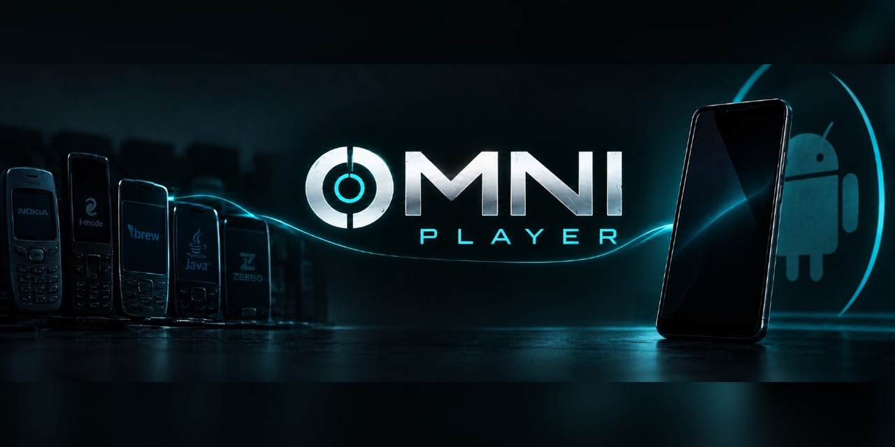

# Omni Player

Your games, together.

Omni Player runs supported old mobile games on **Android 11+ / ARM64** through their individual bridges, bringing them together in one Android app.

The collection covers BREW, DoJa, J2ME, ExEn and Zeebo/BREW, with more games and improvements being added as I work through them.

## Download and play

1. Open the [Omni Player 0.5.8 release](https://github.com/Wakkatobakka/Omni-Player/releases/tag/v0.5.8) and download **Omni-Player-0.5.8.apk**.
2. Install it. Android may ask you to allow installs from your browser or file manager.
3. Open Omni, tap **Load Game**, and select a supported original game download.
4. Tap the game and **Play**.

**Updating an existing public installation?** Install the new APK over it to retain your library and saves.

The bridges are included in Omni. You supply the original game files.

Keep multi-file games in their original ZIP/RAR/7z archive. Supported standalone JAR and EXN files also work. Match the original platform and edition when choosing a download.

ExEn prepares its verified platform runtime automatically on first use; connect once, then use the offline cache. The original EXEN-V2 Emulator ZIP can also be supplied for offline setup.

## What's new in 0.5.8

This update expands Omni beyond the original 24 games while bringing a more consistent gameplay experience across the game interfaces.

Additions include:

- Age of Empires III
- Driv3r
- Duke Nukem 3D
- Spider-Man 2 3D
- The Sims 2: Pets
- Resident Evil: Uprising

There are also updated bridges for many existing games.

See the [0.5.8 release page](https://github.com/Wakkatobakka/Omni-Player/releases/tag/v0.5.8) for the included bridge versions and original-game source links.

The existing [supported-edition reference](SUPPORTED_GAMES.txt) covers the original 0.4.2 collection. It has not yet been expanded to document all the newer additions.

## Still a work in progress

A completed bridge doesn't mean every part of a game is bug-free. There may still be bugs or progression blockers hiding along the way.

If you encounter one, please report it on the [Issues page](https://github.com/Wakkatobakka/Omni-Player/issues). Include the game, what happened, and a report or screenshot if you have one. I'll do my best to stay up with fixes and updates.

N-Gage support is being integrated for a future update.

## Adding more bridges — development workflow

**Menu → Add finished bridges…** imports compatible finished bridge APKs or checkpoint ZIPs.

This is mostly here for my own development workflow right now and has been removed from the public facing app in the current build. The public release already includes the bridges needed for its supported games.

Imported bridges remain installed when their games are removed, allowing the original game files to be loaded again while retaining their existing save locations.

## Why I'm doing this

This is a one-person project, working with AI and testing things around my job and family.

I just think old things are neat. I'm making these games easier to play and share, because getting other people playing them is part of the fun.

Thanks for playing, testing, and helping me bring them back.

## Files and notices

Original game executables, audio, level data and firmware are not bundled in the public player. Decorative title/icon artwork is retained.

See the [component notices included with 0.5.8](https://github.com/Wakkatobakka/Omni-Player/releases/download/v0.5.8/Omni-Player-0.5.8-NOTICES.txt).
