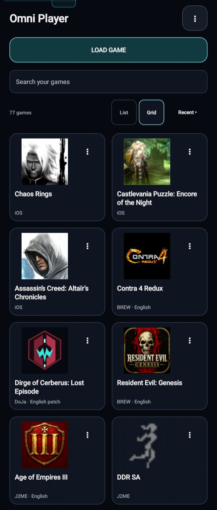

# Old mobile games. One Android home.

Play supported flip-phone, N-Gage, Zeebo, and early iPhone games in one Android app. The compatibility bridges are included. You bring the matching original game files.

[**Download Omni Player**](https://github.com/Wakkatobakka/Omni-Player/releases) · [**Find a game**](#find-a-game) · [Setup help](#setup-help)

**Android 11+ · ARM64 · Public beta**

## 

1. **Install Omni.** Open [Releases](https://github.com/Wakkatobakka/Omni-Player/releases) and download the APK under **Assets** on the newest public beta.
2. **Find your game.** Pick a title from the [game guides below](#find-a-game) and get the matching original edition.
3. **Import and play.** In Omni, tap **Load Game**, select the original file, and tap its tile in the library after it imports.

**Updating?** Install the new public APK over your existing public installation to keep your library and saves.

## 

- **Flip phones, Zeebo, and N-Gage.** [Search the Public Pile by title](https://wakkatobakka.github.io/#games) or open the [Omni Game Guide](./GAME_GUIDE.md#choose-a-game). It covers BREW, DoJa, J2ME, ExEn, Zeebo, classic N-Gage, and N-Gage 2.0.
- **iPhone games.** Use the [Apple Bridge Game Guide](https://github.com/Wakkatobakka/Apple-Bridge/blob/main/GAME_GUIDE.md#choose-a-game) to find your game's original `.ipa`. [Omni v0.6.0](https://github.com/Wakkatobakka/Omni-Player/releases/tag/v0.6.0) added support for importing it straight into Omni. [Apple Bridge](https://github.com/Wakkatobakka/Apple-Bridge) is also available as a standalone iPhone game player for Android.

Each guide lists the editions, filenames, sources, and import notes for its games.

### See it running

| Game | Original platform | Gameplay |
| --- | --- | --- |
| [Final Fantasy VII: Snowboarding](./GAME_GUIDE.md#game-final-fantasy-vii-snowboarding) | DoJa | [Watch](https://wakkatobakka.github.io/videos/omni/ffvii-snowboarding.mp4) |
| [Resident Evil: Genesis](./GAME_GUIDE.md#game-resident-evil-genesis) | BREW | [Watch](https://wakkatobakka.github.io/videos/omni/resident-evil-genesis.mp4) |
| [Mass Effect Infiltrator](https://github.com/Wakkatobakka/Apple-Bridge/blob/main/GAME_GUIDE.md#mass-effect-infiltrator) | iPhone | [Watch](https://www.youtube.com/watch?v=dBjn-ls5UPI) |

[More gameplay clips](https://wakkatobakka.github.io/#gameplay) · [Watch Sonic Jump](https://wakkatobakka.github.io/videos/omni/sonic-jump.mp4)

### Game library

Play with touch controls and haptics, or connect a Bluetooth controller and customize its mapping. Some iPhone game actions still use touch or tilt. Omni fits the full game picture to your screen in portrait or landscape.

Show the library screenshot

  

<a href="./assets/omni/library-screenshot.jpg">Open the full-size screenshot</a>

## 

### Getting the right original files

- **Match the platform and edition.** The same title can have different versions for different phones. Follow the import notes in the guide for your game.
- **Keep multi-file games together.** Load matching ZIP, RAR, or 7z game archives intact. Supported standalone JAR, EXN, and `.n-gage` files can be loaded directly. For iPhone games, import the complete original `.ipa`.
- **ExEn and N-Gage first run.** Connect once so Omni can prepare the platform support, then Omni can reuse those files offline. For offline ExEn setup, supply the original EXEN-V2 Emulator ZIP.

Android may ask you to allow installation from the browser or file manager you used to open the APK.

### Updates and bug reports

The [Releases page](https://github.com/Wakkatobakka/Omni-Player/releases) has the public beta APKs, bridge versions, changes, and component notices for each build. GitHub labels these builds as prereleases.

I personally test each included game through its tutorial and into the first level, often further. Later bugs and progression issues may still turn up.

If a game breaks or the layout looks wrong, [open an issue](https://github.com/Wakkatobakka/Omni-Player/issues) with the game and edition, Omni version, Android device, and what happened. A saved report or short recording helps.

## 

This is a one-person hobby, working with AI by directing, testing and iterating around my job and family.

I just think old things are neat. Getting other people playing these games is part of the fun. Thanks for playing, testing and helping me bring them back.

## 

Players supply the matching original game executables, audio, level data, and firmware. Decorative title and icon artwork is retained.

The game guides distinguish confirmed sources, matching listings, and missing information. Original games, preserved files, translations, and runtime components retain their respective ownership and credits. See the [repository notices](./THIRD_PARTY_NOTICES.txt), the notices in each release, and the [artwork and typography credits](./assets/omni/ARTWORK_NOTES.txt).
