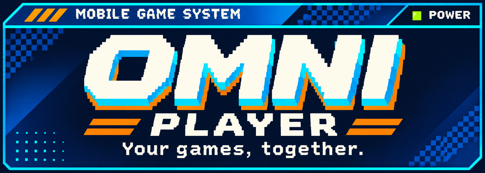
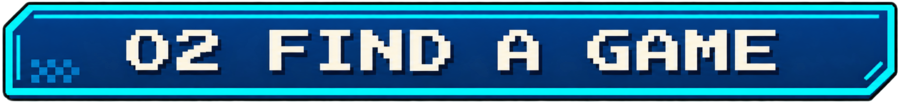
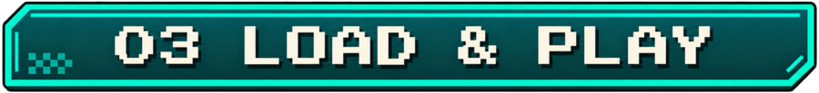
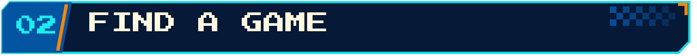
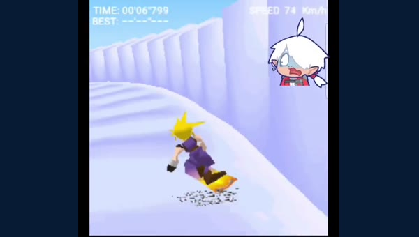
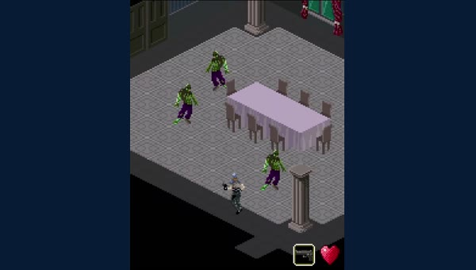
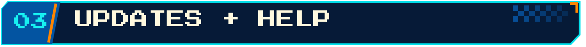
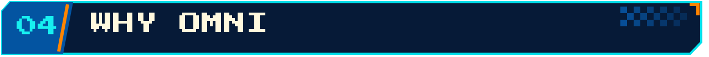
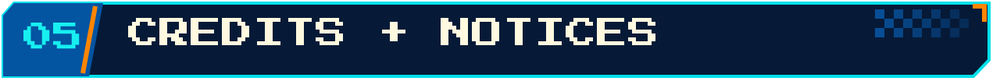

# Old mobile games. One Android home.

Play old flip-phone, N-Gage, Zeebo, and early iPhone games on Android. Bring the matching original files. The compatibility bridges are included.

  
  

**Android 11+ · ARM64 · v0.6.0 beta**

[Get playing](#download-and-play) · [See it running](#see-it-running) · [Setup help](#setup-help)

## 

<table>
  <tr>
    <td width="76%" valign="middle">
      

         
        Open the APK after download.
      

      

         
        Get the matching original game file.
      

      

         
        Open Omni and tap <strong>Load Game</strong>.
      

    </td>
    <td align="center" valign="middle">
      
       
      Game library
    </td>
  </tr>
</table>

## 

- **Flip phones, Zeebo, and N-Gage.** [Search the Public Pile by title](https://wakkatobakka.github.io/#games) or use the [Omni Game Guide](./GAME_GUIDE.md#choose-a-game).
- **Early iPhone games.** Find the listed `.ipa` in the [Apple Bridge Game Guide](https://github.com/Wakkatobakka/Apple-Bridge/blob/main/GAME_GUIDE.md#choose-a-game) and load it directly in Omni v0.6.0. [Apple Bridge](https://github.com/Wakkatobakka/Apple-Bridge) is also available as a standalone player for Android.

Match the edition listed in the guide. Each entry tells you which file to load and where it came from.

### See it running

  

- **Final Fantasy VII: Snowboarding** · [Watch](https://wakkatobakka.github.io/videos/omni/ffvii-snowboarding.mp4) · [DoJa game files](./GAME_GUIDE.md#game-final-fantasy-vii-snowboarding)
- **Resident Evil: Genesis** · [Watch](https://wakkatobakka.github.io/videos/omni/resident-evil-genesis.mp4) · [BREW game files](./GAME_GUIDE.md#game-resident-evil-genesis)

#### Mass Effect Infiltrator

https://github.com/user-attachments/assets/933bbbde-c75e-41d9-8a28-947e0a6763aa

[Game files](https://github.com/Wakkatobakka/Apple-Bridge/blob/main/GAME_GUIDE.md#mass-effect-infiltrator)

#### GTA Vice City

https://github.com/user-attachments/assets/f69c9bd3-9a90-40e7-9d85-1a07151b5a22

[Game files](https://github.com/Wakkatobakka/Apple-Bridge/blob/main/GAME_GUIDE.md#gta-vice-city)

The iPhone clips were recorded in Apple Bridge. [More gameplay clips](https://wakkatobakka.github.io/#gameplay) · [Watch Sonic Jump](https://wakkatobakka.github.io/videos/omni/sonic-jump.mp4)

Play with touch controls and haptics, or connect a Bluetooth controller and customize its mapping. Some iPhone game actions still use touch or tilt. Omni fits the full game picture to your screen in portrait or landscape.

## 

### Load a game

1. Open Omni and tap **Load Game**.
2. Select the matching original file and let the import finish.
3. Tap the game's tile in your library to play.

### Getting the right original files

- **Match the platform and edition.** The same title can have different versions for different phones. Follow the import notes in the guide for your game.
- **Keep multi-file games together.** Load matching ZIP, RAR, or 7z game archives intact. Supported standalone JAR, EXN, and `.n-gage` files can be loaded directly. For iPhone games, import the complete original `.ipa`.
- **ExEn and N-Gage first run.** Connect once so Omni can prepare the platform support, then Omni can reuse those files offline. For offline ExEn setup, supply the original EXEN-V2 Emulator ZIP.

### Updates and bug reports

**Updating?** Install over your existing public build to keep your library and saves. Android may ask you to allow installation from the browser or file manager you used to open the APK.

The [Releases page](https://github.com/Wakkatobakka/Omni-Player/releases) has the public beta APKs, bridge versions, changes, and component notices for each build. GitHub labels these builds as prereleases.

I personally test each included game through its tutorial and into the first level, often further. Later bugs and progression issues may still turn up.

If a game breaks or the layout looks wrong, [open an issue](https://github.com/Wakkatobakka/Omni-Player/issues) with the game and edition, Omni version, Android device, and what happened. A saved report or short recording helps.

## 

This is a one-person hobby, working with AI by directing, testing and iterating around my job and family.

I just think old things are neat. Getting other people playing these games is part of the fun. Thanks for playing, testing and helping me bring them back.

## 

You supply the matching original game files. The game guides distinguish confirmed sources, matching listings, and missing information. Original games, preserved files, translations, and runtime components retain their respective ownership and credits.

See the [repository notices](./THIRD_PARTY_NOTICES.txt), the notices in each release, and the [artwork and typography credits](./assets/omni/ARTWORK_NOTES.txt).
