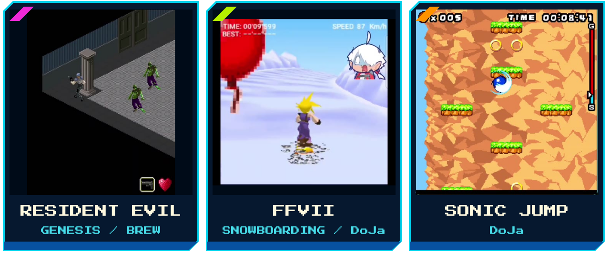
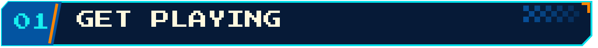
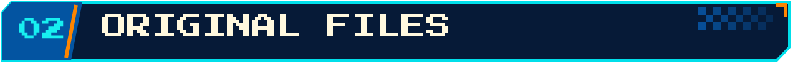

  
  

<strong>BREW · DoJa · J2ME · ExEn · Zeebo · N-Gage</strong>

# Old mobile games. One Android home.

Omni Player brings supported old mobile games and their individual compatibility bridges together in one Android app. **Bring your original game files. Load them in Omni. Play.**

**Android 11+ / ARM64 · Public beta**

The public collection covers BREW, DoJa, J2ME, ExEn, Zeebo/BREW, classic N-Gage and N-Gage 2.0. Play with touch controls and haptic feedback, or connect a Bluetooth controller and customize its button mapping.

[Setup](#download-and-play) · [Original files](#getting-the-right-original-files) · [Updates & help](#public-betas-and-update-history) · [Website](https://wakkatobakka.github.io/#games)

**See them running:** [Resident Evil: Genesis](https://wakkatobakka.github.io/videos/omni/resident-evil-genesis.mp4) · [FFVII Snowboarding](https://wakkatobakka.github.io/videos/omni/ffvii-snowboarding.mp4) · [Sonic Jump](https://wakkatobakka.github.io/videos/omni/sonic-jump.mp4)

## 

1. **Install Omni.** Open [Releases](https://github.com/Wakkatobakka/Omni-Player/releases) and download the APK from the newest public beta. Android may ask you to allow installs from your browser or file manager. Release assets also include the component notices for that build.
2. **Find your original files.** Look up your game in the [game guide](GAME_GUIDE.md). Match its platform, language and edition.
3. **Load and play.** Open Omni, tap **Load Game**, select the original game file, then launch it from your library.

The bridges are included. You do not need separate bridge downloads.

**Updating?** Install the new public APK over your existing public Omni installation to retain its library and saves.

## 

The [game guide](GAME_GUIDE.md) is the maintained list of supported titles, editions, recognizable filenames, source links and import instructions. You can also [search it on the website](https://wakkatobakka.github.io/#games).

Keep multi-file games in their original **ZIP/RAR/7z archive**. Supported standalone **JAR**, **EXN** and **`.n-gage`** files also work. Follow any exception in the game's guide entry; the same title on a different phone platform may be a different game.

**ExEn:** verified platform support is prepared automatically on first use. Connect once, then reuse the offline cache. The original EXEN-V2 Emulator ZIP can also be supplied for offline setup.

**Classic N-Gage and N-Gage 2.0:** platform support is prepared automatically on first use. Connect once for the shared setup; Omni reuses it offline afterward. Choose the matching original game archive or `.n-gage` package listed in the guide.

Source records distinguish confirmed origins, matching listings and missing information. Recovery, preservation and translation credits remain with the people who did that work.

## 

Current public builds are marked as **prereleases** on GitHub while development and testing continue. The [Releases page](https://github.com/Wakkatobakka/Omni-Player/releases) carries downloads, included bridge versions, changes and the notices belonging to each build.

Every included game is personally playtested through its tutorial and into the first level, often further. Full start-to-finish completion hasn't been verified for every title, so later bugs or progression issues may still exist.

**Found a problem?** Open an [issue](https://github.com/Wakkatobakka/Omni-Player/issues). Include the game and edition, Omni version, Android device, what happened, and a saved report or short recording where possible.

**Widescreen support:** widescreen layouts are supported. If your device doesn't play nicely with the layout, let me know through [GitHub Issues](https://github.com/Wakkatobakka/Omni-Player/issues).

## 

This is a one-person hobby, working with AI by directing, testing and iterating around my job and family.

I just think old things are neat. Getting other people playing these games is part of the fun. Thanks for playing, testing and helping me bring them back.

## 

Original game executables, audio, level data and firmware are not bundled in the public player. Players supply the matching originals. Decorative title/icon artwork is retained.

Each release includes its own component notices. Original games, preserved files, translations and runtime components retain their respective ownership and credits. See the [repository notices](THIRD_PARTY_NOTICES.txt) and the notices accompanying your downloaded build.

The gameplay images above are recorded frames from Omni Player. [Artwork and typography credits](./assets/omni/ARTWORK_NOTES.txt).
